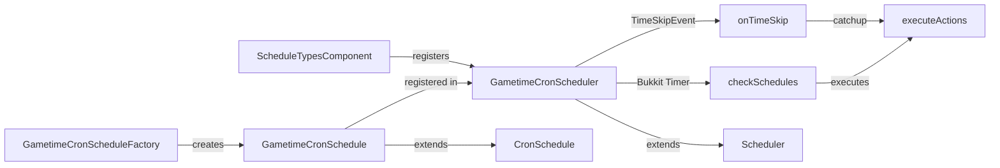

# Requirements

### Overview & Goals

Implementierung von **gametime-cron** Schedules für BetonQuest, die Aktionen basierend auf der Minecraft-Ingame-Zeit
ausführen – analog zu den bestehenden `realtime-daily` und `realtime-cron` Schedules.

### User Story

Als Server-Betreiber möchte ich Schedules definieren können, die zu bestimmten Minecraft-Uhrzeiten (z. B. Mitternacht,
Mittag) Aktionen ausführen, unabhängig von der Echtzeit.

### Functional Requirements
1. **Neuer Schedule-Typ `gametime-cron`**: Unterstützt Cron-Syntax mit Mapping auf Minecraft-Zeit (Stunden/Minuten)
2. **World-Konfiguration pro Schedule**: Jeder Schedule指定t eine Welt, deren Ingame-Zeit verwendet wird
3. **Erweiterter Catchup mit Skip-Optionen**: Zeit-Sprünge durch `/time set`, Bett-Schlafen oder Plugins können optional
   übersprungen werden
4. **TimeSkipEvent + Tick-Fallback**: Nutzt Paper's `TimeSkipEvent` für Zeit-Sprünge, fällt auf tick-basierte Abfrage
   zurück
5. **API-Verbesserungen**: Kleine backward-kompatible Erweiterungen der Schedule-API

### Scope
- **In Scope**: `GametimeCronSchedule`, `GametimeCronScheduler`, `GametimeCronScheduleFactory`, Registrierung in
  `ScheduleTypesComponent`, API-Änderungen in `BaseScheduleFactory` für `world`-Parameter
- **Out of Scope**: `gametime-daily` Typ, Änderungen an bestehenden realtime-Schedules, Dokumentation (wird separat
  gepflegt)

# Technical Design

### Current Implementation

Die bestehende Schedule-Architektur:
- **`Schedule`** (abstrakt): Hält Daten (`ScheduleIdentifier`, `List<ActionIdentifier>`, `CatchupStrategy`)
- **`Scheduler<S, T>`** (abstrakt): Enthält Scheduling-Logik, `getNow()` für aktuelle Zeit, `start()`, `stop()`,
  `executeActions()`
- **`ExecutorServiceScheduler`**: Nutzt `ScheduledExecutorService` für zeitbasierte Ausführung
- **`RealtimeDailySchedule`** / **`RealtimeCronSchedule`**: Konkrete Schedule-Daten
- **`RealtimeDailyScheduler`** / **`RealtimeCronScheduler`**: Konkrete Scheduler mit `Instant` als Zeit-Typ
- **`BaseScheduleFactory`**: Parst gemeinsame Daten (`time`, `actions`, `catchup`)
- **`ScheduleTypesComponent`**: Registriert Schedule-Typen in `ScheduleRegistry`
- **`TimeCondition`**: Zeigt bereits, wie `world.getTime()` gelesen wird (Ticks + 6000 → Stunden/Minuten)

### Key Decisions
1. **Cron-Syntax mit Minecraft-Mapping**: Normale 6-Feld-Cron (Sekunden, Minuten, Stunden, Tag, Monat, Wochentag), aber
   Sekunden=Minuten, Minuten=Stunden, Stunden werden ignoriert (da Minecraft nur 24h/Tag). Z. B. `0 0 12` = 12:00 Uhr
   Minecraft.
2. **Tick-basierte Abfrage + TimeSkipEvent**: Bukkit-Timer prüft alle 10 Ticks die Weltzeit. Zusätzlich `TimeSkipEvent`
   Listener für sofortige Reaktion auf Zeit-Sprünge.
3. **Long-basierte Zeit**: Statt `Instant` wird `long` (Minecraft-Ticks) als Zeit-Typ verwendet, da Ingame-Zeit kein
   ISO-8601-Format hat.
4. **Erweiterter Catchup**: `CatchupSkipOptions` Record definiert, welche Zeit-Sprung-Ursachen übersprungen werden
   sollen (`-bed`, `-command`, `-plugin`).

### Proposed Changes

#### 1. API-Erweiterungen (backward-kompatibel)
- **`BaseScheduleFactory`**: Neuer optionaler `world`-Parameter in `parseScheduleData()`. Bestehende Factories bleiben
  unverändert.
- **`ScheduleData` Record**: Erweitert um `Optional<World> world` Feld.

#### 2. Neue Klassen

**`GametimeCronSchedule`** (erweitert `CronSchedule`):
- Hält `World`-Referenz und `CatchupSkipOptions`
- `getWorld()`: Gibt die konfigurierte Welt zurück
- `getCatchupSkipOptions()`: Gibt die Skip-Optionen zurück
- `getCurrentTime(World)`: Konvertiert `world.getTime()` zu Stunden/Minuten
- `getNextExecutionTicks(World)`: Berechnet nächste Ausführung in Minecraft-Ticks

**`GametimeCronScheduler`** (erweitert `Scheduler<GametimeCronSchedule, Long>`):
- **NICHT** `ExecutorServiceScheduler` – stattdessen direkter Bukkit-Timer
- Bukkit-Timer alle 10 Ticks prüft alle Schedules
- `TimeSkipEvent` Listener für sofortige Reaktion
- `start()`: Startet Bukkit-Timer und registriert Event-Listener
- `stop()`: Stoppt Timer und deregistriert Listener
- `checkSchedules()`: Prüft alle Schedules auf Ausführung
- `catchupMissedSchedules()`: Führt verpasste Schedules aus (mit Skip-Logik)

**`GametimeCronScheduleFactory`** (erweitert `CronScheduleFactory`):
- Parst `world`-Parameter (erforderlich)
- Parst `catchup_skip`-Optionen
- Erstellt `GametimeCronSchedule` mit `CronSchedule.DEFAULT_CRON_DEFINITION` (ohne @reboot)

**`CatchupSkipOptions`** (Record):
- `boolean skipBed`, `boolean skipCommand`, `boolean skipPlugin`
- `parse(String)`: Parst `-bed,-command,-plugin` Format

#### 3. Registrierung
- **`ScheduleTypesComponent`**: Registriert `gametime-cron` Typ mit neuer Factory und Scheduler

### Architecture Diagram


### File Structure
```
code/core/src/main/java/org/betonquest/betonquest/schedule/impl/gametime/cron/
├── GametimeCronSchedule.java
├── GametimeCronScheduler.java
├── GametimeCronScheduleFactory.java
├── CatchupSkipOptions.java
└── package-info.java

Modified:
├── code/core/src/main/java/org/betonquest/betonquest/schedule/impl/BaseScheduleFactory.java
├── code/core/src/main/java/org/betonquest/betonquest/kernel/component/types/ScheduleTypesComponent.java
└── API-CHANGELOG.md
```

### Risks
1. **TimeSkipEvent Verfügbarkeit**: Event existiert nur in Paper/Spigot. Fallback auf tick-basierte Abfrage ist
   notwendig.
2. **Tick-Prüfung Performance**: Bei vielen Schedules kann alle 10 Ticks prüfen teuer sein. Optimierung: nur bei
   Zeitänderung prüfen.
3. **Cron-Mapping**: Das Mapping von Cron-Feldern auf Minecraft-Zeit muss klar dokumentiert sein.

# Testing

### Validation Approach

Unit-Tests für die neuen Klassen, ähnlich den bestehenden Tests für `RealtimeDailySchedule` und `RealtimeCronSchedule`.

### Key Scenarios
1. **GametimeCronSchedule Creation**: Schedule wird korrekt mit World, Cron-Ausdruck und Skip-Optionen erstellt
2. **Time Conversion**: `world.getTime()` → Stunden/Minuten Konvertierung ist korrekt (inkl. +6000 Offset)
3. **Next Execution Calculation**: Nächste Ausführungszeit wird korrekt berechnet
4. **Catchup Skip Options**: Skip-Optionen werden korrekt geparst und angewendet
5. **Scheduler Start/Stop**: Bukkit-Timer wird korrekt gestartet und gestoppt

### Edge Cases
1. **Welt existiert nicht**: Schedule sollte einen Fehler beim Laden werfen
2. **Ungültige Cron-Syntax**: Sollte `QuestException` werfen
3. **Zeit-Sprung über mehrere Tage**: Catchup sollte alle verpassten Ausführungen erkennen
4. **Mehrere Schedules, gleiche Welt**: Alle Schedules sollen korrekt ausgeführt werden
5. **Server-Reload**: Schedules sollen korrekt neu gestartet werden

# Delivery Steps

### ✓ Step 1: API-Erweiterungen in BaseScheduleFactory

Erweitert `BaseScheduleFactory` um optionalen `world`-Parameter und `CatchupSkipOptions`.
- `ScheduleData` Record um `Optional<World> world` und `CatchupSkipOptions skipOptions` erweitern
- `parseScheduleData()` Methode um `world`-Parsing erweitern (optional, default leer)
- `CatchupSkipOptions` Record erstellen mit `skipBed`, `skipCommand`, `skipPlugin` Boolean-Feldern
- `parse(String)` Methode für `-bed,-command,-plugin` Format implementieren
- API-CHANGELOG.md aktualisieren

### ✓ Step 2: GametimeCronSchedule Implementierung

Implementiert die `GametimeCronSchedule` Klasse, die Ingame-Zeit-Daten hält.
- Erweitert `CronSchedule` um `World` und `CatchupSkipOptions` Felder
- `getCurrentTime(World)`: Konvertiert `world.getTime()` + 6000 Offset zu Stunden/Minuten
- `getNextExecutionTicks(World)`: Berechnet nächste Ausführung in Minecraft-Ticks basierend auf Cron
- `getWorld()`, `getCatchupSkipOptions()` Getter
- Unit-Tests für Time-Konvertierung und Next-Execution-Berechnung

### ✓ Step 3: GametimeCronScheduler Implementierung

Implementiert den `GametimeCronScheduler` mit Bukkit-Timer und TimeSkipEvent-Listener.
- Erweitert `Scheduler<GametimeCronSchedule, Long>` (nicht ExecutorServiceScheduler)
- Bukkit-Timer alle 10 Ticks: prüft alle Schedules auf Ausführung
- `TimeSkipEvent` Listener für sofortige Reaktion auf Zeit-Sprünge (mit Reflection für Paper-Fallback)
- `checkSchedules()`: Iteriert alle Schedules, prüft ob aktuelle Zeit Cron-Ausdruck matcht
- `catchupMissedSchedules()`: Führt verpasste Schedules aus, respektiert Skip-Optionen
- `start()`/`stop()`: Verwaltet Timer und Event-Listener
- Unit-Tests für Scheduler-Logik

### ✓ Step 4: GametimeCronScheduleFactory und Registrierung

Implementiert die Factory und registriert den neuen Schedule-Typ.
- `GametimeCronScheduleFactory` erweitert `CronScheduleFactory`
- Parst `world`-Parameter (erforderlich für gametime)
- Parst `catchup_skip`-Optionen (optional)
- Erstellt `GametimeCronSchedule` Instanzen
- `ScheduleTypesComponent` erweitert um `gametime-cron` Registrierung
- `package-info.java` für neues Package erstellen
- Integrationstests: Schedule wird korrekt geladen und registriert
